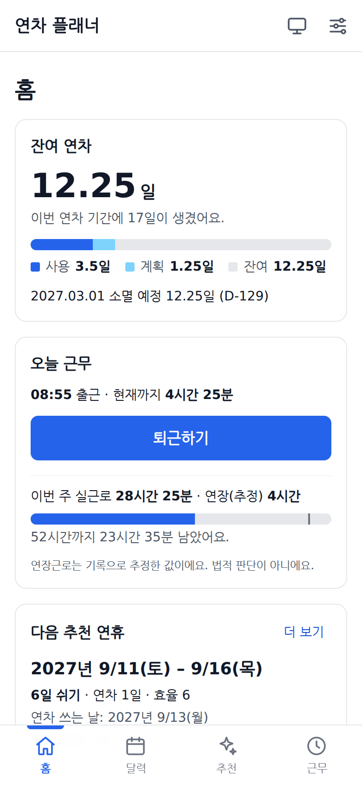
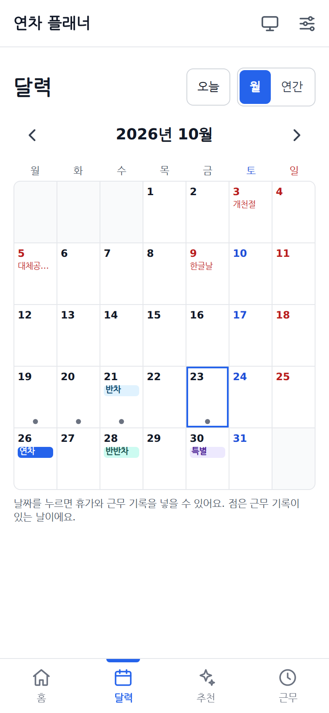
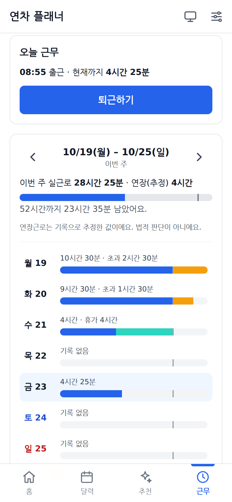
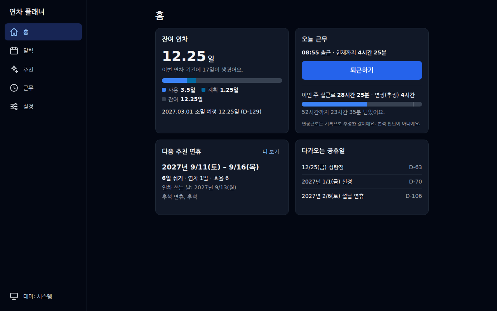

# holidayplanner · 연차 플래너

남은 연차를 근로기준법 기준으로 자동 계산하고, 공휴일 사이 샌드위치 연휴를 추천하고, 09:00–18:00 기준 초과근무와 주 52시간을 정산하는 개인용 웹앱입니다.

- 서버 없음: 모든 데이터는 내 브라우저(IndexedDB)에만 저장됩니다.
- 오프라인 동작: 휴대폰 홈 화면에 설치해 앱처럼 쓸 수 있는 PWA입니다.
- 무료 배포: GitHub Pages.

**바로 쓰기: https://parksh089g.github.io/holidayplanner/**

| 홈 | 달력 | 추천 | 근무 |
| --- | --- | --- | --- |
|  |  |  |  |



## 주요 기능 (MVP)

| 기능 | 설명 |
| --- | --- |
| 연차 자동 산정 | 입사일 기준. 1년 미만 월차, 15일 기본, 2년마다 1일 가산(최대 25일) |
| 휴가 기록 | 연차 / 반차(오전·오후) / 반반차(2시간) / 기타 |
| 잔여 대시보드 | 사용·계획·잔여, 소멸 D-day |
| 공휴일 달력 | 법정공휴일·대체공휴일·선거일 + 회사 휴무일 |
| 샌드위치 연휴 추천 | 연차 n일로 가장 길게 쉬는 구간을 효율순으로 |
| 근무시간 정산 | 출퇴근 기록, 점심 자동 차감, 초과근무, 주 52시간 게이지 |
| 백업·복원 | JSON 파일 내보내기/가져오기 |

## 사용법

1. **설치**: 휴대폰 브라우저로 위 주소를 열고 홈 화면에 추가합니다 (Android Chrome: 메뉴 → 홈 화면에 추가 / iPhone Safari: 공유 → 홈 화면에 추가). 한 번 열어 둔 뒤에는 비행기 모드에서도 열립니다.
2. **처음 시작**: 입사일, 근무시간(기본 09:00–18:00, 점심 12:00–13:00), 현재 연차 기간에 이미 쓴 연차를 입력합니다. 앱이 계산한 현재 연차 기간과 발생 일수를 인사시스템 숫자와 비교하고, 다르면 **설정 → 수동 보정**으로 맞춥니다(이월·포상은 양수, 감액은 음수).
3. **홈**: 잔여 연차와 소멸 D-day, 다음 추천 연휴, 출근·퇴근 버튼과 이번 주 근무시간, 다가오는 공휴일을 봅니다.
4. **달력**: 날짜를 누르면 휴가(연차·특별휴가·병가·기타 × 종일·반차·반반차 × 오전·오후)와 근무 기록을 넣고 고칩니다. 주말·공휴일에는 연차를 넣을 수 없습니다. "연간"으로 12개월을 한눈에 봅니다.
5. **추천**: 연차 최대 일수·최소 연휴·연도·"공휴일 포함만"을 고르면 적은 연차로 길게 쉬는 구간을 효율순으로 보여줍니다. **계획에 넣기**로 연차를 한 번에 등록하고, 토스트의 **되돌리기**로 취소합니다.
6. **근무**: 주 단위로 요일별 정규·초과·휴가 인정 시간과 주 52시간 게이지를 봅니다. 기록이 빠진 날은 **정시로 채우기**로 한 번에 채웁니다. 연장근로는 기록으로 추정한 값이며 법적 판단이 아닙니다.
7. **백업**: 데이터는 이 기기 브라우저에만 있습니다. **설정 → 백업 → 내보내기**로 JSON 파일을 받아 두고, 기기를 바꾸면 **가져오기**로 복원합니다. 가져오기는 전체 교체이며, 바꾸기 전에 지금 데이터를 자동으로 한 번 내려받습니다.

## 기술 스택

React 18 · Vite 5 · TypeScript · Tailwind CSS · Dexie(IndexedDB) · Zustand · date-fns · vite-plugin-pwa · Vitest · Playwright

## 개발

```bash
npm install
npm run dev        # http://localhost:5173/holidayplanner/
npm test           # 단위 테스트 (Vitest)
npx playwright install chromium  # E2E 브라우저 (처음 한 번)
npm run test:e2e   # E2E (Playwright)
npm run build      # dist/ 생성
npm run check:size # JS 번들 gzip 200KB 이하인지 확인
```

`main` 브랜치에 push하면 GitHub Actions가 lint·단위 테스트·빌드·번들 크기·E2E(접근성 포함)를 통과한 뒤 GitHub Pages로 배포합니다.

## 문서

- [docs/SPEC.md](docs/SPEC.md): 개발 명세 (계산 규칙, 데이터 모델, 화면, 테스트 케이스)
- [docs/TASKS.md](docs/TASKS.md): 작업 순서와 완료 조건
- [CLAUDE.md](CLAUDE.md): 코딩 규칙 (사람과 AI 공통)

## 주의

계산 결과는 참고용입니다. 회사 취업규칙과 인사시스템 값이 우선합니다. 공휴일 데이터는 `public/holidays/`의 정적 파일이며, 정부 발표에 따라 갱신이 필요합니다.

v0.1.0의 2026·2027년 공휴일은 민간 정리 자료 기준이며 한국천문연구원 특일정보와 대조하기 전입니다(설정 화면에 "공휴일 데이터 확인 중"으로 표시). 대조를 마치면 다음 버전에 반영합니다.
